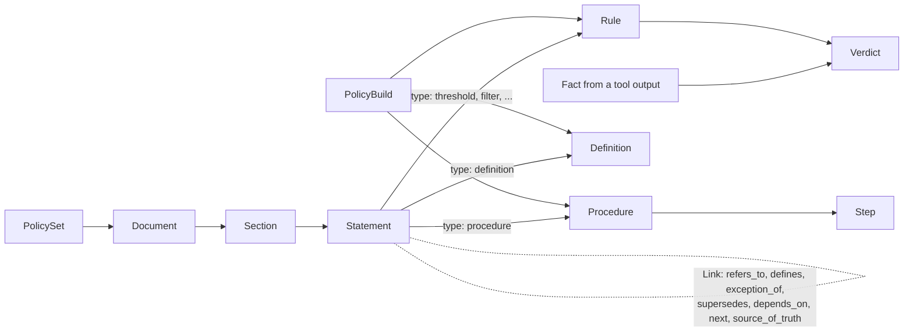

# The policy model

This is how polisys represents a policy after reading it. The same model is used by:

- the **offline builder**, for documents read before the run;
- **online intake**, for policies found during the run (an email, a sheet, a rule in the user's request);
- the **runtime checks** at the host agent's hooks.

Code: `model.py`. Every object has a `source` (document, section, page, line or record id) and a verbatim
`quote`. So every check can name the text it enforces.

## Objects

| Object | What it is | Main fields |
|---|---|---|
| `PolicySet` | All policy that applies to one agent or thread | `documents` (in order), `links`, `version` (hash of document hashes) |
| `Document` | One source: a file, a system prompt, an email, a sheet, a user message | `id`, `kind`, `title`, `trust`, `effective_date`, `authority_rank`, `sections`, `hash` |
| `Section` | A numbered or titled part of a document | `id` (`4.2`, `preamble`), `title`, `page`, `parent`, `statements` |
| `Statement` | One sentence, bullet or table row that says something | `id`, `text`, `types` (at most 2), `modality` |
| `Rule` | A checkable form of statements | `type`, `rule` (the typed rule dict that `ruleset.py` runs), `statement_ids`, `checker`, `may_deny` |
| `Procedure` | An SOP as a step graph | `trigger`, `steps`, `edges` |
| `Step` | One step of a procedure | `action` (tool name or `reply`), `required`, `condition` |
| `Definition` | The meaning of a term | `term`, `meaning`, `used_by` |
| `Link` | A typed edge between two objects, also across documents | `type`, `src`, `dst` |
| `Fact` | Data from a tool output that a check uses | `record`, `tool`, `time`, `trust` |
| `Verdict` | The result of one check | `outcome` (allow, deny, remind, follow_up), `rule_id`, `checker`, `reason`, `remedy`, `latency_ms` |
| `CoverageItem` | What became of a statement, or why nothing did | `statement_id`, `kind`, `reason` |
| `PolicyBuild` | The output of a build; what the runtime loads | `version`, `rules`, `procedures`, `links`, `definitions`, `coverage`, `validation`, `generator` |
| `Obligation` | Work the policy requires, matched against what the agent did. Status will live in the ledger (not built yet) | `id`, `origin`, `scope`, `effect`, `values`, `check`, `level`, `source` |
| `PolicyPackage` | One policy in one JSON file, `schema: "policy-package/1"` | `version`, `policy_hash`, `generator`, `documents`, `rules`, `procedures`, `obligations`, `global`, `links`, `coverage`, `validation`, `policy_questions`, `tests`, `extra` |

`PolicyBuild.generator` and `PolicyPackage.generator` record who built it: `{"kind": "pipeline" | "skill", "harness": ..., "model": ...}`.

For the package, these objects have more fields. They are left out of the JSON when empty, so a build written today is
unchanged:

- `Rule`: `cls` (JSON key `class`: `hard`, `judgment`, `guidance`) and `level` (`observe`, `remind`, `block_once`, `deny`);
- `Step`: `text`. A store graph step is a plain string and becomes `Step(text=...)`; a build step has `action`;
- `Procedure`: `applies_when`, `inputs`, `decisions`, `must_not`, `deadlines`, `links`, `notes`, `priority`, `category`,
  `src`, from the store graph;
- `Document`: `priority_class`;
- `extra` on `Rule`, `Step`, `Procedure`, `Document`, `Section`, `Statement`, `Link`, `CoverageItem`: what a source
  artifact has and the model does not.

`router.py` registers the retrieval methods by name (design section 11): `Router.select(query, package)` gives procedure ids,
`Expander.expand(ids, package)` gives a `Scope` (procedures and rules). The gate reads `Scope.rules`; the ledger reads the ids of
`Scope.procedures` at binding and writes them to the audit. `checkers.router.kind` and `checkers.router.expand` choose the
methods; a registered name is all a new method needs. `model.authority_of` gives a document's rank from the config's
`priority_classes` (highest first), and `validate_package(..., priority_classes=...)` warns about an unknown class.

`package.py` has `load_package`, `save_package`, `from_build`, `to_build`, `from_store_graph` and `to_store_graph`. Round
trip is per format: `to_build(from_build(x)) == x` and `to_store_graph(from_store_graph(x)) == x`. Conversion does not
merge the two formats.

Runtime components read a package through `from_package(pkg, ...)`: `RuleSetHooks`, `ProcedureStore`, `ProcedureGuide`,
`SopLoop`, `SopNavigator` and `StoreGate`. A run builds them this way, through `build_runtime` from a profile; offline
tools and tests also use the plain constructors. `model.step_text()` is the one way to read a step in words.

`RuleSetHooks` reads a rule's `level` (one of `RULE_LEVELS`) as the default when no measured setting applies. A method
choice for the rule's type and `verifier_may_deny=True` win over it. `schema_conflict` and `may_deny: false` are limits it
cannot raise. `verifier_may_deny=False` is the default and means no setting: a `verify` rule then never denies, and level
`observe` still lowers it. A duty keeps its follow-up path and guidance stays in the brief, whatever the level.
`block_once` denies until the rule has stopped one call in the session, then reminds. A converted rule's level is what
the code does with no method choice, so a converted package behaves as its build did. `from_package` raises `ValueError`
on an unknown level, and where a component would have no effect: `StoreGate` with no store and no `sop_text`, or with
nothing in the package to check; `SopNavigator` with no sections.

The brief of `RuleSetHooks` lists the rules that name a tool in the run. Two settings add to it, both off by default so a
measured brief does not change. `brief_guidance` (config `notes.brief_guidance`) also lists the guidance rules that name no
tool. `exception_links` (rule id to the ids of its exceptions; `from_package(..., with_exceptions=True)` reads them from the
package's `exception_of` links through `package.exception_links`, and the runtime sets it when the shapes include `rules`)
writes each exception under its rule, once, instead of as an item of its own.

## Making a package with the skill

`skill/SKILL.md` tells an agent in any harness how to make a package from the policy text and the tool schemas only. The
agent writes one `draft.json`, and `cli pack` joins it with the converted documents:

| Draft key | Content | Becomes |
|---|---|---|
| `modality` | statement id → `must`, `must_not`, `may`, `should` | `Statement.modality`; a statement with none needs no outcome |
| `rules` | `{id, class, level, statement_ids, quote, rule: {type, ...}}` | `PolicyPackage.rules`; `pack` fills `type`, `checker`, the id and the quote inside `rule` |
| `procedures`, `obligations`, `links`, `coverage`, `policy_questions` | as the fields of the package | the same fields |
| `global` | `global_rules`, `triage`, `routing`, `escalation`, `templates`, `calendar`, `definitions`, ... | `PolicyPackage.global_` |
| `tests` | decision tests; `--tests FILE` replaces them | `PolicyPackage.tests` |

`pack` sets `schema`, `version` and `policy_hash` (one hash of the statements' texts as the converter split them, so a
change of the converter can move it) and `generator`: `{"kind": "skill", "harness": ..., "model": ...}`, the same shape as
`PolicyBuild.generator`. It fills a step's `text` from its `id`. It stops, and writes nothing, on an id that does not exist
(statements, steps, `scope.procedure`, `links.to`, `rule_ids`, definition sources, test statements), a step text that does not
contain its statement, an unknown draft key or modality, or a test with no `tool` or no `expected` of `allow` or `deny`. It
writes the statements with no modality to `<output>.unmarked.txt`. `validate` (without `--legacy`) then decides whether the
package is complete and whether it is the policy's own words.

**What counts as the outcome of a `must` or `must_not` statement** (`validate.py`, `_coverage_errors`): a rule that lists
the statement in `statement_ids` (its `class` gives hard, judgment or guidance); a procedure step whose `id` is the
statement id; a procedure `preconditions`, `exceptions`, `templates` or `escalations` item, or an obligation
`source.quote`, that copies at least 4 words of it; a `global.definitions` item with `source.statement`; a policy
question that lists it; or a `coverage` item `out_of_scope` with a reason. A procedure's `must_not` and `decisions` and
everything under `global` are read at run time but do not count: the same statement also has a step or a rule.

**Text the package must come from** (`validate.py`, `_invented_errors`; `quote_not_verbatim`): an obligation
`source.quote`, a part's `quote`, a step's `text` and every must-not are checked against the documents' text, whitespace and
emphasis marks aside. A step `text` may join a statement with the one the converter split from it. A must-not is verbatim, or
a condition and a prohibition of at least 3 words each, each verbatim. A role of a role rule must be named in the text.

**What the runtime reads** (`package.to_store_graph`, `ProcedureStore`): `procedures` as a store graph (steps as text,
`decisions`, `must_not`, `deadlines`, `notes`, `links`, and the parts, which `procedure_text` prints when present) and
these `global` keys, each in one shape: `global_rules` `[{id, src, rule, attach_when?}]`; `triage`, `housekeeping`,
`escalation` `{name, src, steps: [text], must_not: [text]}`; `priority` `{name, src, levels: [text]}`; `routing`
`{category: {field: value}}`; `templates` `{number-as-cited: {number, name, slots, text}}`; `calendar` `{workdays: [0-6],
holidays: [ISO date]}`; `definitions` `[{term, meaning, source}]`. Another key is dropped, so `validate` warns
(`unknown_field`); a value of another shape crashes the store or is lost, so `validate` reports `invalid_field`. The guide
and the SOP loop read `procedures` as a build: a step needs `action` (a tool of the tool list, or `reply`) to be stopped on.

**Obligation values and their matching** (design section 5, "Value binding"; no ledger exists yet: Task 4.1 implements this
contract, and `validate` already checks what it can). `values` maps a name to `{"from": origin, ...}`. Origins: `literal`
(`value`), `template` (`pattern`), `computed` (`fn`, `args?`), `case_fact` (`field`, `record`), `request` (`about`).
`effect.match` maps an argument of the tool to `{"pattern": text}`; the text holds `{name}` or `{name:format}` for values of
the obligation (`{{` and `}}` are braces). A value is **matched** when a pattern names it, directly or through a matched
`template` value, and only a matched value is compared with a call. A value no pattern names is an **unmatched value**: shown
in the follow-up, never compared (`unbound_value`, a warning; an **unbound item** is something else: an item with no case).
"Wrong" is said only of a matched `literal`, `template` or `computed` value. The test depends on the argument: an enum or a
boolean is a full match; a code argument (`code`, `command`) or an argument of JSON text is a contains test (found gives
`met`, not found gives `unknown`, never `wrong`); `to`, `cc`, `bcc` match one element of a list or of comma-separated text;
other text is contains after folding. Every `match` argument must exist in every tool of the obligation, and an obligation on
both code tools has a pattern for `code` and for `command` (`unknown_arg` otherwise). `scope.procedure` names the procedure;
a `scope` without it (also `{}`) applies to every case; `scope.when` keys are answered from the case with quoted evidence (no
answer gives `unknown`, not sent), preferably the id of a procedure decision. A policy question lists `open_values:
["<obligation id>.<value name>"]`; only a `literal` named there is refused (`literal_open_question`). A value with no origin
is not asserted. A skill package sets `origin: package`, `check: code`, `level: observe`.

**Words the checks compare** (`validate.py`): text is compared after folding spaces, emphasis marks, case, every dash to a
hyphen and curly quotes to straight ones. `not_in_text` and `bare_must_not` are warnings: global rules, the `rule` of each decision, escalation
and triage steps, definitions, notes and `applies_when` are verbatim or up to three runs of at least 3 verbatim words;
template text, literal values (not on enum or boolean arguments) and the fixed parts of template values are verbatim; a
must-not under 5 words, or one that starts with a pronoun, cannot be read alone. HTML keeps its en and em dashes through
docling (`documents._hold_dashes`); a dash that starts a line is still the bullet it was.

**Decision tests** are cases `{tool, args, reads: [{tool, args, result}], role, expected: "allow" | "deny", why,
statement_id, by}`. They are a measurement input, written by an agent that has not seen the rules, and stored in
`tests`; they never change a rule.

## Statement types

A statement has one or two types. The type decides how it is handled and which checker runs it.

| Type | Example | First-choice checker |
|---|---|---|
| `allowed_values` | "priority must be one of low, normal, urgent" | code |
| `lookup_matrix` | shipping class from weight band × zone | code |
| `state_transition` | "new → in progress → resolved" | code |
| `required_field` | "every ticket needs a requester" | code |
| `derived_value` | "shipping fee = (weight × rate) + handling" | code |
| `threshold` | "refunds above $500 need approval" | code |
| `role_permission` | "only managers may close a ticket" | Cedar |
| `approval` | "the site engineer must approve a major repair" | monitor + Cedar |
| `prohibition` | "do not schedule visits to a locked site" | code if a field test, else verifier |
| `eligibility_filter` | "skip assets whose Notes contain an AUDIT- code" | code on the records the call names |
| `routing` | "plumbing tickets go to the site engineer" | verifier |
| `deadline` | "respond within 24 hours" | verifier |
| `notification_duty` | "notify the owner when status changes" | monitor |
| `procedure` | "1. check, 2. approve, 3. close" | step-graph monitor |
| `exception_override` | "emergency payments may skip step 3" | a link, folded into the rule it changes |
| `definition` | "overdue = more than 30 days since inspection" | a link, used by other rules |
| `format` | "ticket IDs as TCK_###" | code |
| `source_of_truth` | "the asset register takes precedence over the desk spreadsheet" | a link between data sources |
| `open_judgment` | "use judgment for urgent tickets" | verifier, or the brief only |

The checker actually used per type is set by measurement in `method_choice.json`. A type may deny only when its
false-deny rate is 2% or less; otherwise it only reminds.

## Modality and links

- **Modality:** `must`, `must_not`, `may`, `should`.
- **Link types:**
  - `refers_to`: "see §4.3";
  - `defines`: a term's meaning;
  - `exception_of`: the source is an exception to the target (a rule list shows it under the target rule, and `validate`
    warns, `exception_without_rule`, when no rule holds one end);
  - `supersedes`: the source replaces the target;
  - `depends_on`: the source applies only together with the target;
  - `next`: procedure order;
  - `source_of_truth`: the source *data* record wins over the target for a value.

A link is kept only if both ends exist. A pointer with no target becomes a `CoverageItem` of kind
`dangling_link`, never a rule.

## Precedence

When two statements disagree, `resolve_conflict(a, b, policy_set)` picks the winner:

1. A **trusted** source beats an untrusted one, even if the untrusted one says it supersedes.
2. An explicit **`supersedes`** link (between the statements, their sections or their documents).
3. The newer **effective date** of the document.
4. The higher **authority rank** of the document.

If none of these decides, the result is `None`. Both statements then become **advisory**: they appear in the
brief, and neither denies. Document order alone does not decide.

## Worked examples (accounts-payable policy, `tests/fixtures/ap_policy.md`)

1. **An exception far away.**
   - §4.2 step 3 says to run the three-way match (§4.3) before approval.
   - §8.1 says an emergency payment may skip the matching step (§4.2 step 3).
   - Links:
     - `§4.2.3 refers_to §4.3`;
     - `§8.1 exception_of §4.2.3`;
     - `§2 defines` "emergency payment".
   - The rule `match_before_approval` carries `unless: emergency payment (§8.1)`. The check therefore allows an
     emergency payment without a match, but only with CFO approval.
2. **A category exception with a limit.**
   - §8.2 lets utilities, taxes and government fees go without a PO, with AP Manager approval up to $25,000.
   - Statement types: `exception_override` + `threshold`.
   - The PO rule gets a second `unless` condition. A `threshold` rule caps those categories at $25,000.
3. **An update document.**
   - A later memo changes one limit.
   - It is a second `Document` with a newer `effective_date` and a `supersedes` link to the old clause.
   - `resolve_conflict` keeps the memo's limit.
   - If the memo came from an untrusted sender, the old limit stays, and the memo appears in the brief as
     unverified.
